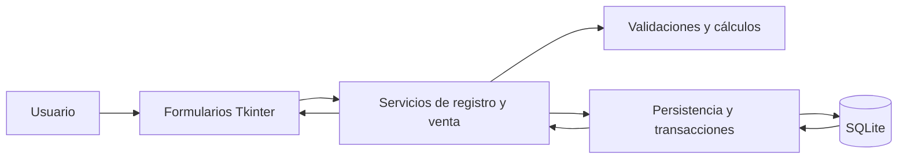
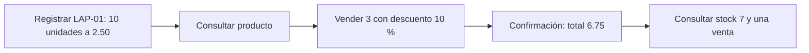

# Práctica 3 — pruebas de software

**Proyecto:** sistema de inventario y ventas.  
**Tecnología:** Python, Tkinter y SQLite.  
**Asignatura:** Proyecto de Sistemas II.  
**Fecha de ejecución:** 11 de noviembre de 2026, America/Caracas.  
**Integrantes:** completar con los nombres del equipo.  
**Modalidad de aceptación:** simulada mediante automatización de la interfaz real.

## 1. Objetivo y alcance

Comprobar que un inventario valida los datos, calcula valores monetarios, conserva los registros y mantiene consistentes los módulos de ventas y existencias. Se desarrollaron los diez ejercicios del enunciado con pruebas unitarias, de integración y de aceptación.

El sistema permite registrar productos con código único, consultar existencias y registrar ventas con un descuento máximo del 20 %. No utiliza servicios externos. Para el ejercicio 6 se eligió la alternativa permitida de integrar la lógica de negocio con la base de datos.

La rúbrica se aborda con la cobertura de todos los ejercicios (**completo, 40 %**), resultados reproducibles y cálculos explícitos (**correcto, 40 %**) y documentos relacionados por identificadores de prueba (**organizado, 20 %**). Esta correspondencia no constituye una calificación del docente.

## 2. Reglas de negocio

| ID | Regla |
| --- | --- |
| RN-01 | El código tiene de 2 a 20 letras, números o guiones, comienza con letra o número y se normaliza a mayúsculas. No admite duplicados. |
| RN-02 | El nombre es obligatorio y tiene entre 2 y 80 caracteres después de quitar espacios exteriores. |
| RN-03 | El stock es entero entre 0 y 999999, ambos inclusive. |
| RN-04 | El precio está entre 0.00 y 999999.99 y admite hasta dos decimales; se acepta punto o coma decimal. |
| RN-05 | Una venta requiere un producto existente y una cantidad entera positiva que no supere sus existencias. |
| RN-06 | El descuento es obligatorio, inicialmente 0, entre 0 % y 20 %, inclusive, con hasta dos decimales. |
| RN-07 | El total de venta se redondea a centavos con redondeo comercial; los importes se almacenan en centavos enteros. |
| RN-08 | Guardar una venta y reducir el stock es una operación atómica: se completan ambos cambios o se revierten ambos. |
| RN-09 | Los errores esperados se muestran con mensajes comprensibles; una operación rechazada conserva la integridad de los registros. |

## 3. Arquitectura y método

Los archivos `inventario/dominio.py`, `servicios.py`, `persistencia.py` e `interfaz.py` separan las reglas puras, la coordinación, la base de datos y los formularios. La interfaz es la utilizada tanto en la demostración como en la aceptación simulada.

- **Unitarias:** funciones puras con entradas controladas, sin formularios ni base de datos.
- **Integración:** servicios, formularios y conexiones reales a SQLite, según el caso. El fallo de persistencia se induce con un bloqueo exclusivo real; el fallo intermedio de una venta se induce con un trigger de prueba.
- **Aceptación:** se introducen valores en los campos de Tkinter, se invocan los botones y se comprueban los mensajes y tablas del usuario, además de los datos guardados. No se utilizó un evaluador humano independiente.

Cada prueba con persistencia crea una base temporal nueva. El archivo `evidencias/demostracion.sqlite3` conserva únicamente el flujo visual documentado; la base de trabajo habitual de la aplicación es independiente.

## Ejercicio 1. Validación de datos de entrada

**Dato elegido:** cantidad inicial de un producto. **Función:** `validar_cantidad`, en [dominio.py](../inventario/dominio.py). **Regla:** RN-03.

La función devuelve un entero si la entrada cumple la regla; de lo contrario genera `ErrorValidacion` con un mensaje específico. La cantidad cero es válida para un producto sin existencias.

| Caso | Entrada | Resultado esperado | Resultado observado |
| --- | --- | --- | --- |
| E01-01 | 10 | Entero 10 | Coincide |
| E01-02 | Vacía | Cantidad obligatoria | Coincide |
| E01-03 | -1 | Rechazo por cantidad negativa | Coincide |
| E01-04 | 1000000 | Rechazo por superar 999999 | Coincide |
| E01-05 | abc | Rechazo por formato no entero | Coincide |
| E01-06 | 0 | Entero 0, límite inferior | Coincide |
| E01-07 | 999999 | Entero 999999, límite superior | Coincide |
| E01-08 | 1.5 | Rechazo por formato fraccionario | Coincide |
| E01-09 | None | Cantidad obligatoria | Coincide |

**Resultado:** 9/9 pruebas cumplen. Código: [test_unitarias.py](../pruebas/test_unitarias.py), clase `ValidacionCantidad`. La [tabla de ejecución E01](../evidencias/RESULTADOS.md#e01-validación-de-cantidades) conserva los resultados exactos.

## Ejercicio 2. Cálculo de valores del sistema

**Cálculo elegido:** valor del stock de un producto. **Función:** `calcular_valor_stock`. **Fórmula:** `cantidad × precio unitario`.

El precio y la cantidad se validan previamente. Se utiliza `Decimal` para la aritmética monetaria y el resultado se expresa con dos decimales. Se permite stock o precio igual a cero.

| Caso | Cálculo manual del resultado esperado | Obtenido |
| --- | --- | ---: |
| E02-01 | 10 × 2.50 = 25.00 | 25.00 |
| E02-02 | 0 × 2.50 = 0.00 | 0.00 |
| E02-03 | 7 × 0.00 = 0.00 | 0.00 |
| E02-04 | 3 × 19.99 = 59.97 | 59.97 |
| E02-05 | 999999 × 999999.99 = 999998990000.01 | 999998990000.01 |

**Resultado:** 5/5 pruebas cumplen, incluyendo los ceros y el límite superior permitido. El resultado grande del último caso sigue siendo exacto porque no se utilizan números binarios de punto flotante para los importes.

## Ejercicio 3. Reglas de validación y restricciones

**Regla elegida:** RN-06, descuento entre 0 % y 20 %. **Función:** `validar_descuento`.

| Caso | Entrada o cálculo | Resultado esperado y observado |
| --- | --- | --- |
| E03-01 | 0 % | Aceptado |
| E03-02 | 10 % | Aceptado |
| E03-03 | 20 % | Aceptado: límite inclusivo |
| E03-04 | -0.01 % | Rechazado: negativo |
| E03-05 | 20.01 % | Rechazado: supera el límite |
| E03-06 | diez | Rechazado: formato incorrecto |
| E03-07 | 1.001 % | Rechazado: más de dos decimales |
| E03-08 | 1 × 0.05 × (1 − 10/100) = 0.045 | Total 0.05 por redondeo comercial |

**Resultado:** 8/8 cumplen. E03-08 comprueba además `calcular_total_venta`. No se detectaron defectos de estas reglas en los casos ejecutados. Los problemas encontrados en el conjunto de la práctica se documentan en [DEFECTOS.md](DEFECTOS.md).

## Ejercicio 4. Integración entre formulario y base de datos

**Módulos:** formulario de registro → `Inventario.registrar_producto` → validadores → `BaseDatos.conexion` → tabla `productos`. El diagrama de arquitectura muestra ese recorrido.

| Caso | Acción | Comprobación y resultado |
| --- | --- | --- |
| E04-01 | Guardar LAP-01, Lápiz HB, 10, 2.50 desde el formulario | Una consulta SQL independiente devuelve exactamente el código, nombre, cantidad 10 y precio de 250 centavos. Cumple. |
| E04-02 | Guardar con nombre vacío | Mensaje de dato obligatorio y ninguna inserción. Cumple. |
| E04-03 | Registrar LAP-01 y luego lap-01 | Mensaje de duplicado y registro original sin cambios. Cumple. |
| E04-04 | Guardar con cantidad -1 | Se ejecuta la validación y no se guarda el producto. Cumple. |
| E04-05 | Consultar desde otra instancia del servicio | El producto continúa almacenado, con 10 unidades y precio 250 centavos. Cumple. |

**Resultado:** 5/5 cumplen. La evidencia del formulario está en [02_producto_guardado.png](../evidencias/02_producto_guardado.png); los datos por interacción se conservan en [resultados.json](../evidencias/resultados.json). La base final de demostración refleja la venta posterior y, por tanto, contiene 7 unidades.

## Ejercicio 5. Integración entre dos módulos funcionales

**Módulo 1:** registro de ventas. **Módulo 2:** control de existencias. Una venta válida debe aparecer en el historial y reducir la cantidad disponible del mismo producto.

| Caso | Escenario | Resultado esperado y observado |
| --- | --- | --- |
| E05-01 | Vender 3 de 10, a 2.50 con 10 % | Stock 7, una venta por 675 centavos. |
| E05-02 | Vender 11 de 10 | Rechazo; productos y ventas idénticos a su estado anterior. |
| E05-03 | Vender exactamente 10 de 10 | Stock 0 y una venta. |
| E05-04 | Trigger provoca fallo al insertar una venta después de reducir el stock | Error controlado y reversión de ambos cambios. |
| E05-05 | Dos solicitudes simultáneas de 7 unidades con stock 10 | Una venta admitida, otra rechazada, stock 3 y un registro de venta. |

**Consistencia:** `BEGIN IMMEDIATE` reserva la escritura antes de consultar el stock. La actualización y la inserción comparten una conexión y una transacción. Una excepción provoca rollback, y las claves foráneas enlazan las ventas con productos existentes. Las restricciones de SQLite refuerzan los límites del stock y del precio.

**Resultado:** 5/5 cumplen. La comprobación concurrente utiliza dos conexiones reales. La [captura de venta](../evidencias/03_venta_realizada.png) muestra la actualización coordinada de ambas tablas.

## Ejercicio 6. Integración entre aplicación y componente

**Alternativa del enunciado aplicada:** lógica de negocio ↔ base SQLite. No se añadió un servicio externo artificial. La dependencia que puede fallar es la persistencia.

| Caso | Condición | Resultado esperado y observado |
| --- | --- | --- |
| E06-01 | Registro y consulta correctos | La respuesta contiene LAP-01. |
| E06-02 | Otra conexión ejecuta `BEGIN EXCLUSIVE` | Agotado el tiempo de espera de 0.15 s, se obtiene `ErrorPersistencia` con mensaje comprensible. Tras liberar el bloqueo, se comprueba que no hubo cambios. |
| E06-03 | Intento fallido, liberación del bloqueo y reintento | La nueva venta se completa: stock 8 y una venta. |

**Tratamiento del error:** la capa de persistencia traduce `sqlite3.Error` a un error de aplicación. El formulario muestra «No se pudo acceder a la base de datos. Intenta de nuevo.», conserva los datos y permite repetir la operación. E10-07 comprueba también este comportamiento desde la interfaz.

**Resultado:** 3/3 cumplen. Las respuestas y las comparaciones de estado están documentadas en los resultados; el [guion](GUION_ACEPTACION.md) permite reproducir manualmente el bloqueo.

## Ejercicio 7. Aceptación del registro de información

**Usuario:** encargado del inventario. **Precondición:** aplicación abierta y base de prueba vacía. **Datos:** LAP-01, Lápiz HB, 10 y 2.50.

| Criterio | Evidencia de aceptación | Estado |
| --- | --- | --- |
| Campos y botón de registro disponibles | E07-01; captura 01 | Cumple |
| Un registro válido se confirma, se guarda y puede consultarse | E07-02; captura 02 y consulta SQL de E04-01 | Cumple |
| Un dato obligatorio faltante produce un mensaje y puede corregirse | E07-03: nombre vacío, corrección y registro válido | Cumple |
| Una operación contraria a las reglas se impide | E07-04: precio negativo sin inserción; E04-03 y E09-01: duplicado | Cumple |

**Resultado:** 4/4 casos de aceptación del ejercicio cumplen. Los errores conservan los campos para permitir su corrección; un guardado correcto limpia los campos de registro y actualiza la consulta.

## Ejercicio 8. Aceptación de un proceso completo

**Proceso central:** registrar un producto, vender parte de sus unidades y comprobar el inventario y el historial.

**Precondiciones:** base vacía, formularios disponibles y ninguna venta anterior. **Criterios:** registro consultable, venta confirmada con total correcto, reducción exacta del stock y coherencia del historial al actualizar.

1. Ingresar los datos del producto y pulsar Guardar producto. Se muestra LAP-01 con 10 unidades y valor de stock 25.00.
2. Ingresar LAP-01, cantidad 3 y descuento 10; pulsar Registrar venta.
3. Verificar el total manual: `3 × 2.50 × (1 − 10/100) = 6.75`.
4. Pulsar Actualizar consultas. Comprobar stock `10 − 3 = 7`, valor de stock `7 × 2.50 = 17.50` y una venta con total 6.75.

**E08-01:** el flujo completo cumple. **E08-02:** al vender todas las unidades, el stock llega a cero; un nuevo intento se rechaza sin otra venta. **Resultado:** 2/2 cumplen. Las [cinco capturas](../evidencias/README.md) y [flujo_formularios.json](../evidencias/flujo_formularios.json) conservan el recorrido y los estados observados.

## Ejercicio 9. Aceptación de escenarios excepcionales

| Caso | Situación | Comportamiento esperado | Resultado observado |
| --- | --- | --- | --- |
| E09-01 | Código de producto duplicado | Explicar el duplicado y conservar el original | Mensaje específico; no cambia ningún registro. Cumple. |
| E09-02 | Cantidad de producto ausente | Indicar que la cantidad es obligatoria y no guardar | Mensaje comprensible; tablas vacías. Cumple. |
| E09-03 | Venta de 11 unidades con stock 10 | Rechazar por falta de existencias y conservar ambos módulos | Mensaje específico; mismo stock y mismo historial. Cumple. |
| E09-04 | Venta de un código inexistente | Informar que el producto no existe y no insertar ventas | Mensaje específico; tablas vacías. Cumple. |

**Resultado:** 4/4 cumplen. No se hallaron bloqueos de aceptación en estos casos. Las [capturas 04 y 05](../evidencias/README.md) muestran dos rechazos reales y la conservación de la información.

## Ejercicio 10. Validación final con el usuario

**Funcionalidad prioritaria:** registrar ventas con stock e historial consistentes. Se establecieron siete criterios verificables: campos disponibles, cantidad obligatoria, descuento máximo, rechazo del descuento excesivo, actualización coordinada, rechazo por falta de stock y recuperación ante indisponibilidad de la base.

El [guion de aceptación](GUION_ACEPTACION.md) incluye preparación, datos, pasos, resultados esperados, reproducción del bloqueo y una tabla para que otra persona registre sus observaciones.

Los casos **E10-01 a E10-07** comprobaron los siete criterios desde la interfaz. El [acta de aceptación](../evidencias/ACTA_ACEPTACION.md) registra **7/7 cumplidos**, sin defectos funcionales pendientes detectados en el alcance probado.

**Decisión:** aceptada con observaciones, en **evaluación simulada**. Se cumplen los criterios comprobados; queda pendiente una evaluación por una persona independiente para recoger observaciones de claridad y usabilidad. No se atribuye a un usuario real una ejecución que no realizó.

## 4. Resultados globales y cierre

| Nivel | Ejercicios | Pruebas ejecutadas | Cumplen |
| --- | --- | ---: | ---: |
| Unitarias | 1–3 | 22 | 22 |
| Integración | 4–6 | 13 | 13 |
| Aceptación simulada | 7–10 | 17 | 17 |
| Total | 1–10 | 52 | 52 |

Las tablas completas con resultados esperados y obtenidos están en [RESULTADOS.md](../evidencias/RESULTADOS.md). La salida de ejecución está en [ejecucion.txt](../evidencias/ejecucion.txt); los defectos corregidos y sus comprobaciones, en [DEFECTOS.md](DEFECTOS.md).

La base de demostración conserva LAP-01 con 7 unidades y precio de 250 centavos; el historial conserva una venta de 3 unidades con 10 % y total de 675 centavos. `PRAGMA integrity_check` devuelve `ok` y `PRAGMA foreign_key_check` no devuelve infracciones, como muestra [consultas_sql.txt](../evidencias/consultas_sql.txt).

La funcionalidad satisface los escenarios definidos en el entorno probado. Esta conclusión se limita a esa cobertura; no supone una validación de producción ni una aceptación humana definitiva.
