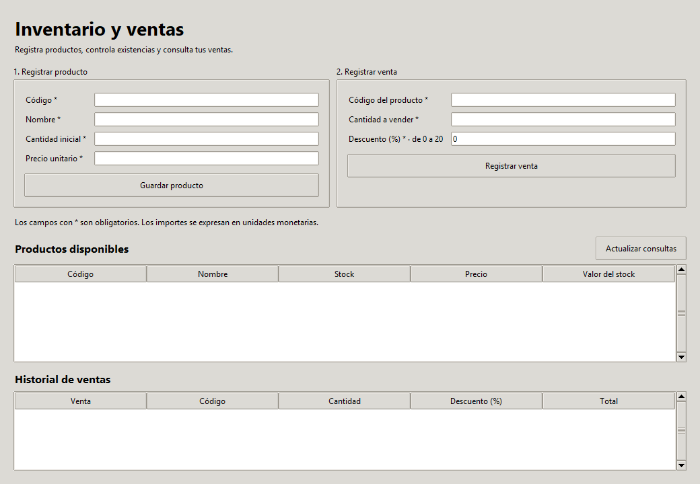
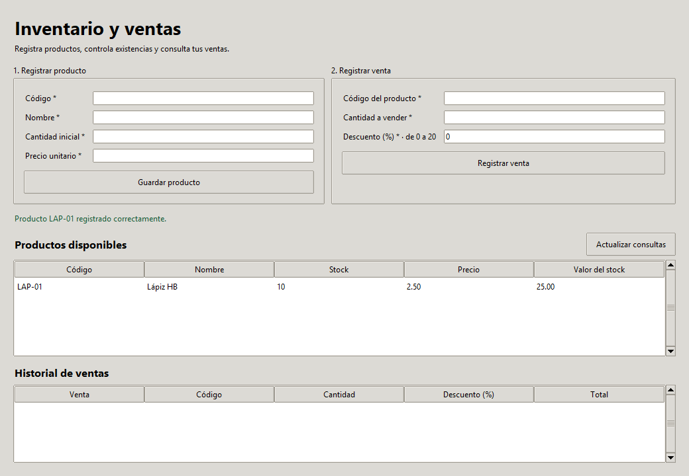
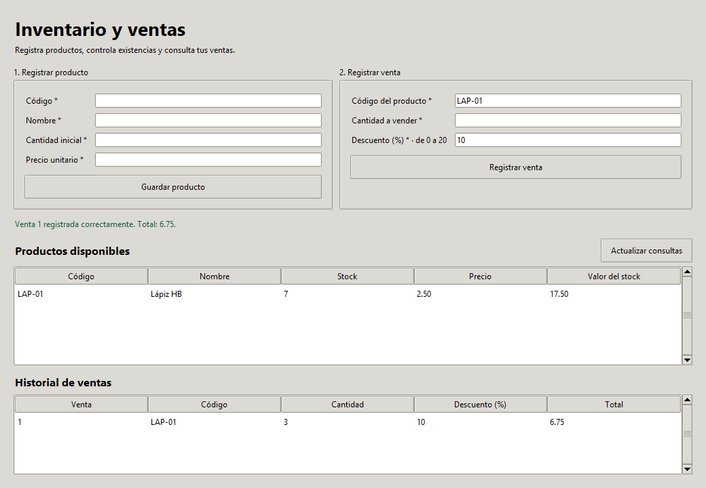
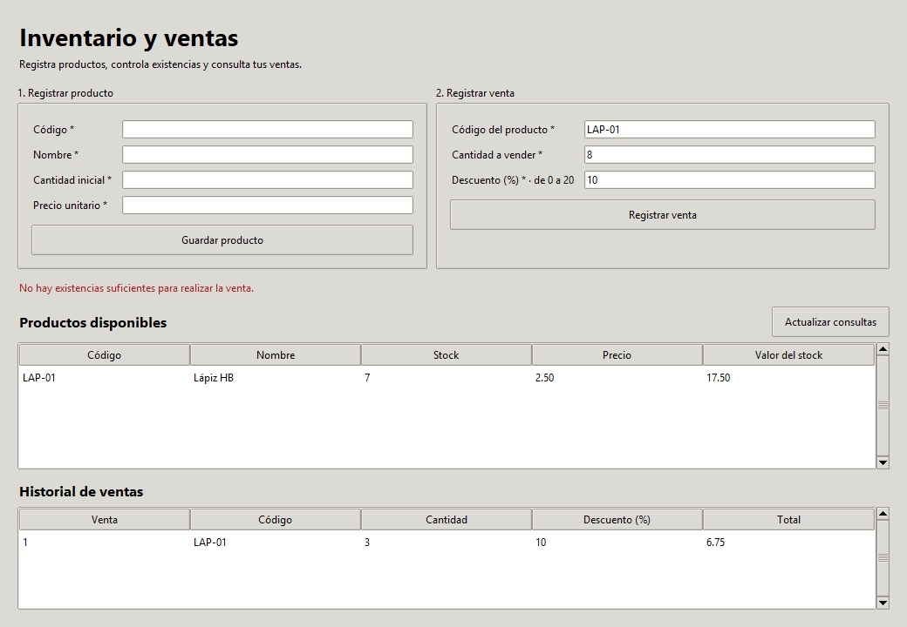
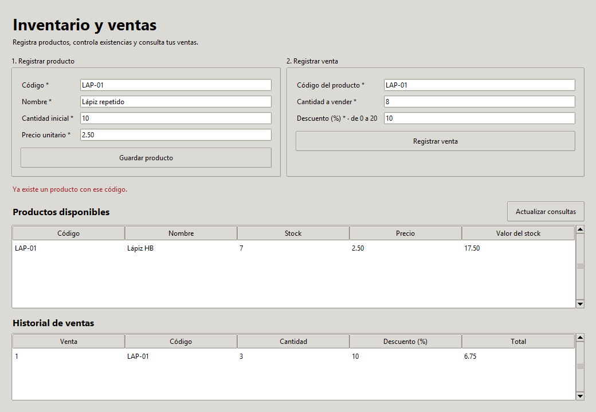

# Evidencias de ejecución

Los archivos se generaron ejecutando el sistema y sus pruebas. Las imágenes son capturas de la ventana real del inventario; no son maquetas.

| Archivo | Evidencia |
| --- | --- |
| [RESULTADOS.md](RESULTADOS.md) | Tablas de los 52 casos con entradas, resultados esperados y obtenidos |
| [resultados.json](resultados.json) | Metadatos del entorno, duración, estado e interacciones capturadas por caso |
| [ejecucion.txt](ejecucion.txt) | Salida completa de unittest: 52 pruebas, resultado OK |
| [ACTA_ACEPTACION.md](ACTA_ACEPTACION.md) | Validación final simulada de siete criterios |
| [flujo_formularios.json](flujo_formularios.json) | Entradas, mensajes y estado de SQLite en los cinco pasos de demostración |
| [consultas_sql.txt](consultas_sql.txt) | Consultas de productos y ventas, integridad general y claves foráneas |
| [demostracion.sqlite3](demostracion.sqlite3) | Copia de la base final del flujo demostrado, independiente de la base de trabajo |
| [diagnostico_conexion.txt](diagnostico_conexion.txt) | Ejecución previa que encontró D-02, antes de su corrección |

## Formulario disponible



## Producto guardado y consultable

Entrada: LAP-01, Lápiz HB, cantidad 10 y precio 2.50. Se muestra el mensaje de confirmación y el valor del stock de 25.00.



## Venta y actualización de existencias

Venta de 3 unidades con 10 % de descuento: `3 × 2.50 × 0.90 = 6.75`. Quedan 7 unidades, con valor de stock de 17.50. El historial muestra una sola venta.



## Operación rechazada por falta de existencias

Se solicitan 8 unidades cuando quedan 7. Se muestra un mensaje comprensible y se conservan el stock y la única venta anterior.



## Código duplicado rechazado

Se intenta registrar nuevamente LAP-01. El nombre original, el stock y el historial permanecen intactos.



## Estado persistido final

```text
productos: ('LAP-01', 'Lápiz HB', 7, 250)
ventas:    (1, 'LAP-01', 3, '10', 675)
PRAGMA integrity_check: [('ok',)]
PRAGMA foreign_key_check: []
```

Los importes `250` y `675` están guardados en centavos: 2.50 y 6.75. Para consultar la copia desde la aplicación, ejecutar `python app.py --db evidencias/demostracion.sqlite3`; cualquier modificación hecha en esa sesión cambiará esa copia de evidencia.
